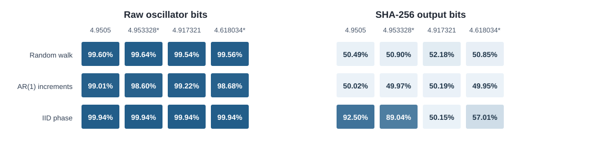

# Two Identical Histograms. Two Very Different Futures.

Why a failed prediction test does not prove a signal is unpredictable.

## Opening — Two Identical Histograms

Imagine you have two sequences in front of you, each consisting of 74,160 integers ranging from 0 to 99.

First, you count the frequency of each number in both sequences and plot their histograms. The two histograms are identical, bin for bin. Every number appears exactly the same number of times in both sequences.

But can you predict which number comes next in each sequence?

We used a simple periodicity-based predictor and evaluated its first-guess accuracy on a held-out test segment. The results were striking:

- Sequence 1 prediction accuracy: **100.00%**
- Sequence 2 prediction accuracy: **1.34%** (close to the 1% chance level for 100 possible values)

*Figure 1. Experiment A: An original sequence and its fully shuffled counterpart share identical occurrence counts across 74,160 integers. The top panel shows their shared empirical histogram; the bottom panel shows first-guess accuracy on a chronologically held-out test segment. Accuracy was 100.00% for the original order and 1.34% after shuffling.*

If the two sequences have identical distributions, why is one so much easier to predict?

Once you know the trick, it is simple: one sequence is arranged in a regular, periodic order, while the other is a completely shuffled version of it.

A histogram shows the marginal distribution—which values appear and how frequently—but not the temporal dependence between successive values. That is where the sequence's "memory of order" can hide.

This is more than a statistical puzzle. The same distinction matters when evaluating random number generators, sensor signals, and cryptographic hash outputs. An output that looks random does not, by itself, establish that the underlying signal is unpredictable.

## Section 1 — A Random-Looking Output Can Still Have a Memory

A number-guessing game is a familiar exercise for people learning Python. While teaching programming to elementary school students as a part-time job, I decided to build one myself and experimented with different implementations.

Since my research focuses on analog semiconductor circuit design, I gradually became interested in games that combined software with hardware. Along the way, my interest expanded into how random numbers are generated. While building and testing several random number generators, I stumbled upon the phenomenon presented in this article.

What particularly intrigued me was how the regularity in an original sequence changes when passed through SHA-256.

To investigate this question, let's use a synthetic model of a ring oscillator (RO), a circuit commonly used in hardware random number generators.

We set the oscillation frequency to $f_{\mathrm{RO}} = 50\text{ MHz}$ (a period of $20\text{ ns}$) and the oscillation-to-sampling frequency ratio to $r = 4.9505$ (a sampling frequency of approximately $10.10\text{ MHz}$). In this experiment, a "jitter of $5\text{ ps}$" refers to $\sigma_t$, the standard deviation of the time error added to the phase increment between samples in a cumulative phase random walk model. The standard deviation of the phase increment error normalized to the oscillation period is $f_{\mathrm{RO}}\sigma_t$.

In this experiment, we divide the generated raw bit sequence into 256-bit blocks and hash each block separately with SHA-256, producing one 256-bit digest per block. This is our experimental choice: SHA-256 does not require a 256-bit input.

What happens if there is zero noise (jitter) in the system? Due to the mathematical properties of the frequency ratio, the raw bit sequence repeats the exact same pattern with a period of 2,000 bits. Consequently, the SHA-256 output—processed in 256-bit blocks—also becomes a perfect repeat with a period of 32,000 bits. By memorizing a template of the past 32,000 bits, one can predict the future of even the SHA-256 output with 100% accuracy.

Next, we introduce a small amount of synthetic cumulative phase jitter: a 5-picosecond (ps) standard deviation in the timing error added at each sampling step. This models one kind of timing uncertainty that can arise in real oscillators; it is not a measurement of a physical device. Using the same fixed-template predictor on the SHA-256 output, we obtain:

- 0 ps jitter: 100% prediction accuracy (fixed-template prediction of SHA output)
- 5 ps jitter: 49.99% prediction accuracy (using the same predictor)

In a binary prediction task, 49.99% is essentially chance-level performance. Under this fixed-template test, adding only 5 ps of per-step jitter was enough to eliminate the predictor's earlier advantage. But that result tells us about this predictor—not about every possible way to predict the signal.

It would be premature to conclude that the underlying signal had become random. Did SHA-256 eliminate the regularity, or did it merely make that regularity harder for our predictor to detect? To answer that, we need to examine what happens inside each hash input block.

*Did the underlying signal become unpredictable, or did our predictor simply lose the pattern it was using?*

## Section 2 — Why the Hash Output Stops Repeating

The key to understanding this abrupt shift lies in our experimental setup, where SHA-256 is applied to inputs partitioned into 256-bit blocks. Even if most of the raw bits are reproduced, a difference of just a single bit within a block destroys the reproducibility of the output for that input. To see this in action, we examined three "match rates" at a lag of 32,000 bits:

1. The periodic match rate of the raw bits
2. The exact match rate of the entire 256-bit SHA-256 input blocks

3. The match rate of the SHA-256 output bits

SHA-256 exhibits the "avalanche effect," a property where a small change in the input propagates across the entire output. Generally, when two input blocks differ, about half of the corresponding output bits are expected to match. Note that this is a statistical property and does not mean that exactly half of the bits flip for every single input pair.

Let us define $q$ as the proportion of 256-bit input blocks that match their comparison target exactly, and $s$ as the proportion of corresponding SHA-256 output bits that match when the input blocks differ.

The match rate of the output bits, $p_{\mathrm{SHA}}$, can then be expressed as:

$$
p_{\mathrm{SHA}} = q + (1 - q)s
$$

This is an identity partitioned into matching and non-matching input cases. Furthermore, because the output bit match rate for differing input blocks was approximately 50% ($s \approx 0.5$) in our dataset, we can approximate this as:

$$
p_{\mathrm{SHA}} \approx \frac{1 + q}{2}
$$

Under the $5\text{ ps}$ condition, the measured exact match rate for input blocks ($q$) was 1.19%. The SHA-256 output bit match rate predicted from this value is 50.60%, which aligns closely with the 50.62% obtained in our simulation.

*Figure 2. Experiment D: Match rates at a 32,000-bit lag as a function of jitter magnitude. Compares RO raw bits, exact match rates of 256-bit SHA-256 input blocks, and SHA-256 output bit match rates. Aggregated over 30 seeds ($0\text{ ps}$ is deterministic); error bars indicate 95% confidence intervals. Note that this represents fixed-lag match rates, not predictor accuracy.*

Under the same $5\text{ ps}$ condition, the lag match rate of the raw bits was 92.52%. Despite this high rate, the exact match rate for full 256-bit input blocks dropped to 1.19%, bringing the SHA-256 output bit match rate down to 50.62%. A high match rate in the raw bits and an approximately 50% match rate after hashing can coexist.

Crucially, SHA-256 did not create a new physical source of randomness. Because any discrepancy within a block cascades across the entire digest, the regularity remaining in the raw bits simply becomes difficult to observe in the hashed output when viewed at the same lag. Note that what we are measuring here is the bit match rate at a fixed lag, not the upper bound of accuracy across all possible predictors.

## Section 3 — What Happens When the Predictor Is Allowed to Search?

If regularity still remains in the underlying raw bits, can we extract it?

This is where the experiment gets truly interesting. Next, rather than giving the predictor theoretical periods like 2,000 or 32,000 in advance, we let it search the data on its own to find usable periods (lags).

To ensure a fair evaluation, we strictly partitioned the time-series data chronologically into three splits:

- 50% Discovery: The split used to search for candidate useful lags.
- 20% Validation: The split used to select the best lag from the candidates.

- 30% Test: The unseen split used to measure final prediction accuracy.

The final test split is never used for lag discovery or selection. During testing, however, the predictor operates in an online sequential manner, meaning it can reference previously observed test bits prior to the bit currently being predicted. It never uses the current ground truth or future bits to make a prediction.

Here are the results of applying this "lag-searching predictor" to three targets under the $5\text{ ps}$ jitter condition:

**Table 1. Experiment F: Online blind-lag prediction at 5 ps**

| Prediction target | Online test accuracy |
|:--|--:|
| **RO raw bits** | **99.60%** |
| SHA-256 output | 50.59% |
| Shuffled raw-bit control | 49.96% |

*Figure 3. Experiment F: Online next-bit prediction accuracy for RO raw bits (left) and SHA-256 output (right). Data was partitioned chronologically into 50% discovery, 20% validation, and 30% test, with lags selected exclusively using the discovery and validation splits. During testing, bits observed prior to the prediction step are accessible. Non-zero jitter conditions are aggregated over 12 seeds; error bars indicate 95% confidence intervals.*

It is important to distinguish the evaluation conditions here. The ~50% figure in Section 1 was the accuracy of predicting the SHA-256 output using a fixed template. In contrast, the 99.60% figure here is the accuracy of online prediction on RO raw bits based on an unknown-lag search. These two numbers do not directly compare the superiority of predictors on the exact same dataset. Explicitly stating both the prediction target and the historical information available is a vital premise of this experiment.

Even for the SHA-256 output, searching for lags was not entirely meaningless. Under the $2\text{ ps}$ condition in Experiment F, the mean accuracy of the unknown-lag search reached 53.38%, outperforming the 52.29% of the predictor pre-configured with a fixed 32,000 lag. The lag most frequently selected by the searcher was 15,616—which aligns with block boundaries as $15,616 = 61 \times 256$, and closely matches the phase as $15,616 \times 4.9505 = 77,307.008$. However, a difference of roughly 1.10 percentage points is not enough to claim definitive statistical superiority, and at $5\text{ ps}$, prediction accuracy on the SHA-256 output remains at 50.59%.

Why, then, did RO raw bits achieve 99.60% accuracy even at $5\text{ ps}$? Let's examine the 101-lag selected at $5\text{ ps}$ and the inverted relationship at the 10-lag utilized under higher jitter conditions.

## Section 4 — Why a Short Imperfect Period Can Beat a Perfect Long One

Why were approximate periods like lag 101 or lag 10 more useful than the exact theoretical period of lag 2,000? To answer this, we must consider both rational approximations of phase and the accumulation of noise.

Under the $5\text{ ps}$ condition, what the predictor discovered was not the exact theoretical period of 2,000, but a short approximate period at a lag of 101.

Because our oscillation-to-sampling frequency ratio is $4.9505$:

$$
101 \times 4.9505 = 500.0005
$$

At a distance of 101 samples, the oscillator's phase returns almost exactly to its original position. Under higher jitter conditions of $20\text{–}50\text{ ps}$, the predictor exploited a different relationship:

$$
10 \times 4.9505 = 49.505
$$

A signal 10 samples away is shifted by almost exactly half a period. Therefore, by inverting the bit from 10 samples ago, the predictor can estimate the current bit with high accuracy.

Why does a short approximate period hold an advantage over the exact period of 2,000?

The phase difference at lag $L$ can be separated into a deterministic phase offset $\delta_L$ and the stochastic phase increments that accumulate over that interval:

$$
\Delta\phi_L = \delta_L + \sum_{k=n-L+1}^{n}\varepsilon_k, \qquad \sigma_{\Delta\phi}(L) = f_{\mathrm{RO}}\sigma_t\sqrt{L}
$$

Here, $\varepsilon_k$ represents the independent phase increment noise normalized to the oscillation period. In our model with a $50\text{ MHz}$ frequency and $5\text{ ps}$ jitter per step, this yields the following values:

**Table 2. Phase-offset and jitter comparison at 5 ps**

| Lag (samples) | Deterministic phase offset (time equivalent) | Accumulated jitter, standard deviation (time equivalent) |
|--:|--:|--:|
| 101 | 10 ps | approximately 50 ps |
| 2,000 | 0 ps | approximately 224 ps |

While a lag of 2,000 has zero deterministic phase offset, it accumulates substantially more noise than a lag of 101. Under the $5\text{ ps}$ condition in Experiment F, the unknown-lag search achieved 99.60% accuracy, whereas the pre-specified 2,000-lag predictor achieved 98.20%. This aligns with the trade-off between deterministic phase offset and noise accumulation. Note, however, that simply adding these two time values does not directly yield the bit error rate; phase wrapping and quantization thresholds also play a role.

At $50\text{ ps}$, the raw-bit match rate at a 32,000 lag in Experiment D was 49.62%, whereas the unknown-lag online prediction accuracy in Experiment F was 98.50%. The former is a descriptive statistic at a fixed lag, while the latter is prediction accuracy under a different evaluation protocol. While the two metrics should not be conflated, they demonstrate how dramatically observable regularity can change depending on the lag and observation conditions.

## Section 5 — Change the Noise Model, Change the Conclusion

In the cumulative phase random walk model used thus far, the prediction accuracy of the SHA-256 output dropped to around 50%. However, this does not mean that passing a signal through SHA-256 will always result in 50% accuracy. Does the same thing happen if the temporal structure of the input changes? To find out, we varied the noise generation model. Keeping the frequency ratio at $4.9505$ and the jitter parameter at $5\text{ ps}$, we compared three different models of phase noise injection:

- Cumulative Phase Random Walk: Deviations accumulate continuously over time (used in the experiments so far).
- AR(1) Phase Increment: An accumulative model where the step-to-step deviations have slight temporal correlation.

- Independent Phase Perturbation: Deviations are reset at each step and do not accumulate over time.

It is important to note here that the numerical setting of "$5\text{ ps}$" assigned to the three noise models does not represent physically equivalent noise power across them.

In a cumulative random walk, fluctuations in phase increments pile up over time. In the AR(1) model, those increments are temporally correlated. In the independent phase perturbation model, however, the phase deviation at each sample is drawn independently, and past deviations never accumulate.

Therefore, this comparison is not "an experiment applying three types of noise of equal strength," but rather "a sensitivity analysis assuming different temporal noise-generation processes."

With this distinction in mind, we compared post-SHA-256 prediction performance across the noise models. Below are the results from Experiment G using a frequency ratio of $4.9505$, jitter of $5\text{ ps}$, and 6 seeds. Unlike Experiment F (12 seeds, 50% discovery / 20% validation), Experiment G uses a discovery budget of 192,000 bits, validation of 40,000 bits, and a final test split of 30%. Consequently, the 50.59% in F and 50.50% in G are not identical estimators, nor do the 32,000-lag match rates in Experiment D directly match the descriptive statistics from G's separate seeds.

The results are as follows:

**Table 3. Experiment G: Prediction accuracy at 5 ps and ratio 4.9505**

| Noise model | Raw-bit prediction accuracy | SHA-256 prediction accuracy |
|:--|--:|--:|
| Cumulative phase random walk | 99.60% | **50.50%** |
| AR(1) phase increments | 99.01% | **50.02%** |
| Independent phase perturbations | 99.94% | **92.50%** |

*Figure 4. Experiment G: Comparison of three phase noise models and online next-bit prediction accuracy at a frequency ratio of $4.9505$ and jitter setting of $5\text{ ps}$. Blue bars represent RO raw bits; orange bars represent SHA-256 outputs. Values are means across 6 seeds; error bars indicate 95% confidence intervals. A numerical setting of $5\text{ ps}$ does not imply physically equivalent noise strength across models.*

Under the independent phase perturbation model, prediction accuracy on the SHA-256 output reached 92.50%. However, this does not mean this model always yields high accuracy. Let's compare the results of Experiment G across different frequency ratios:

**Table 4. Experiment G: SHA-256 prediction with independent phase perturbations at 5 ps**

| Oscillation-to-sampling ratio | SHA-256 prediction accuracy |
|--:|--:|
| 4.9505 | **92.50%** |
| approximately 4.953328 | **89.04%** |
| approximately 4.618034 | **57.01%** |
| 4.917321 | **50.15%** |

The $\approx 4.953328$ condition is an irrational ratio defined in our implementation as $4.9505 + 0.002\sqrt{2}$. Even so, it achieved an accuracy of 89.04%. An exact rational ratio is not strictly required. Within the scope of our experiment, what matters is whether a good approximate period aligned with 256-bit block boundaries exists within the search range, and how reliably it is reproduced under noise. This connects directly back to the number-theoretic phase relationships discussed in Section 4.

*Figure 5. Experiment G: Online next-bit prediction accuracy across four frequency ratios and three phase noise models at a $5\text{ ps}$ jitter setting. Left panel shows RO raw bits; right panel shows SHA-256 outputs. Each cell represents the 6-seed mean (darker shades indicate higher accuracy), evaluated using 192,000 discovery bits, 40,000 validation bits, and a 30% final test split. Frequency ratios "4.953328\*" and "4.618034\*" are rounded displays of $4.9505 + 0.002\sqrt{2}$ and $4 + (\sqrt{5}-1)/2$, respectively. The $5\text{ ps}$ value does not imply physically equivalent noise strength across models.*

Why does this happen? Because phase deviations do not accumulate in the independent phase perturbation model, input blocks are much more likely to be reproduced even at distant points in time. Under this model, the exact match rate for 256-bit blocks at a 32,000-bit lag was approximately 84.96%. This explains the mechanism by which a high match rate survives in the SHA-256 output—though note that this block match rate and the 92.50% online prediction accuracy in the table are distinct evaluation metrics.

In actual free-running ring oscillators, phase noise often accumulates from frequency fluctuations, and RO-based TRNGs are specifically designed to harvest such physical jitter as an entropy source. However, real hardware is also subject to power supply variations, temperature drift, and correlated noise, meaning our simple random walk model does not fully represent physical silicon. Similarly, the independent phase perturbation model serves as a control for comparison and is not a general model of PLL clocks.

What Experiment G demonstrates is that even with the exact same SHA-256 function, the predictability of the output depends heavily on the combination of the phase noise's temporal structure and the sampling ratio. The 92.50% figure is simply the outcome obtained under one specific combination of those conditions.

## Section 6 — What a Failed Prediction Test Actually Tells Us

Through the experiments above, we are finally equipped to answer the overarching question posed at the beginning. When we run a prediction test on a signal and get a result of "50% (prediction failure)," what does that actually mean?

Low prediction accuracy merely demonstrates that under the given information, algorithm, and observation conditions, that specific predictor failed to achieve sufficient accuracy.

It does not prove any of the following:

- That all regularity and information in the underlying data-generation process have been lost.
- That a predictor taking a different approach could never predict the signal.

- Much less that the output is "cryptographically secure" or "possesses sufficient true entropy."

(Note: All experiments in this study are based on synthetic RO models and are not measurements from physical devices. Furthermore, the fixed-template prediction in Section 1, the simple match rates in Section 2, and the online predictions in Sections 3 and 5 were each designed under different evaluation conditions. For detailed implementations, confidence intervals, per-seed results, and additional model comparisons, please refer to the GitHub repository linked at the end of this article.)

When evaluating data randomness or predictability in practice, we must always explicitly specify the following five-point checklist to avoid being misled by a single accuracy score:

1. What is being predicted? (Is it the raw signal itself, or the output after transformation by a hash function or conditioner?)
2. What historical information can the predictor access? (Is it restricted to a fixed template, or does it update sequentially online?)

3. Were features or periods given in advance? (Was it fed theoretical values, or allowed to search and discover them from the data?)
4. What assumptions are made about the noise and data-generation process? (Does the noise accumulate over time, or is it independent?)

5. What dependencies were checked beyond prediction accuracy? (What do the match rates look like across multiple lags or at the block level?)

## Closing — Randomness Is Not a Single Number

Think back once more to the "two histograms" from the opening.

The two sequences shared the exact same distribution (histogram). Yet, because their order differed, their future predictability diverged starkly between 100% and 1.34%.

Similarly, even if a given predictor achieves only 50% accuracy on the output of SHA-256, it does not guarantee that no predictable structure remains in the underlying signal. In our random walk model, we were able to predict the raw bits with 99.60% accuracy by exploiting a short approximate period. And under a specific combination of independent phase perturbation and frequency ratio, we achieved 92.50% prediction accuracy even on the SHA-256 output itself. Both results are valid within their specified models and prediction protocols.

Perhaps the most striking takeaway from these experiments is that while SHA-256 obscured periodic matches, that result alone said almost nothing about the predictability of the underlying source signal.

Randomness and unpredictability cannot be judged by a single number from a single test.

Prediction accuracy describes a particular experiment. It is not a universal certificate of randomness.

## References and Reproducibility

- [1] NIST, Recommendation for the Entropy Sources Used for Random Bit Generation, NIST SP 800-90B (2018). https://doi.org/10.6028/NIST.SP.800-90B
- [2] M. Baudet, D. Lubicz, J. Micolod, A. Tassiaux, On the Security of Oscillator-Based Random Number Generators, Journal of Cryptology 24, 398–425 (2011). https://doi.org/10.1007/s00145-010-9089-3

- [3] A. Peetermans, V. Rožić, I. Verbauwhede, Design and Analysis of Configurable Ring Oscillators for True Random Number Generation Based on Coherent Sampling, ACM Transactions on Reconfigurable Technology and Systems (2021). https://doi.org/10.1145/3433166

Figure 5 can be recreated from the [Experiment G summary CSV](../data/experiment_G_highlights.csv) using the [Python regeneration script](../experiments/plot_G_ratio_sensitivity.py).

Implementation details can be verified in [the unknown-lag search code](../experiments/experiment_F.py), [the noise-model comparison code](../experiments/experiment_G.py), [the evaluation protocol audit](evaluation_protocol_audit.md), and [the theoretical notes on phase recurrence](phase_recurrence_theory.md). All results are derived from synthetic RO models and do not constitute physical device measurements, validations of hardware entropy rates, or evaluations of the cryptographic security of SHA-256.
