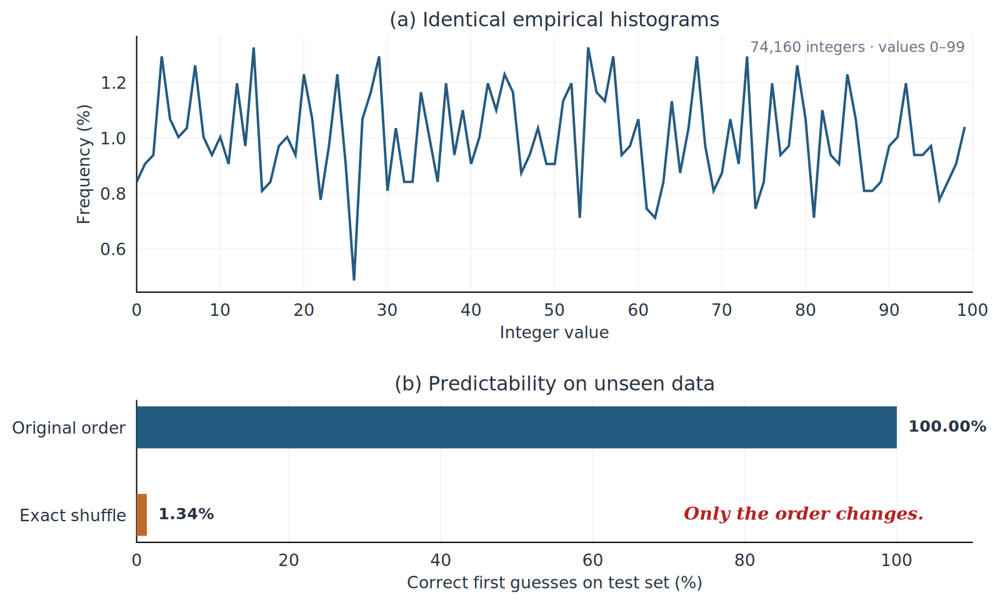
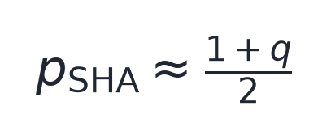
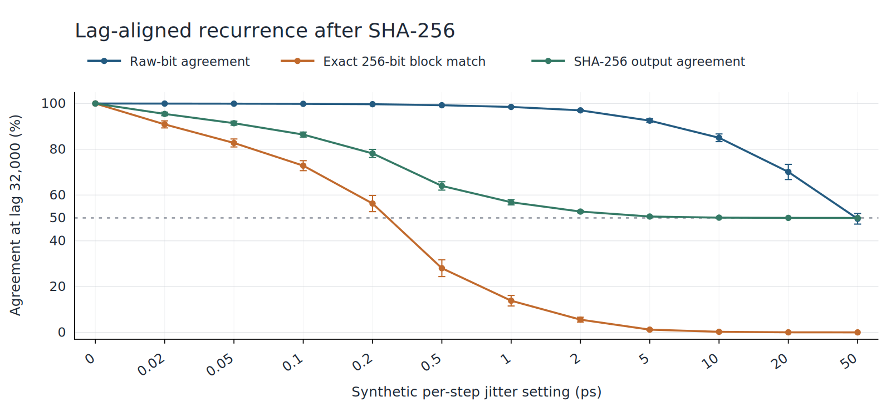
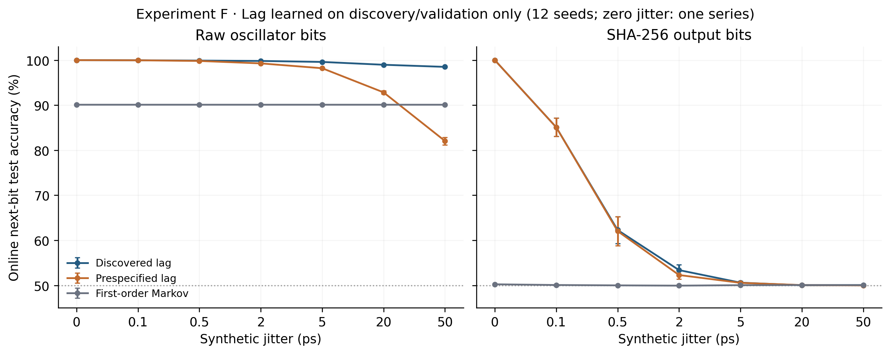
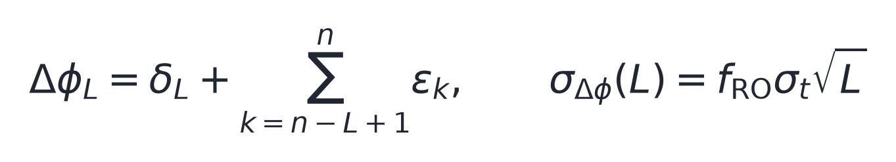
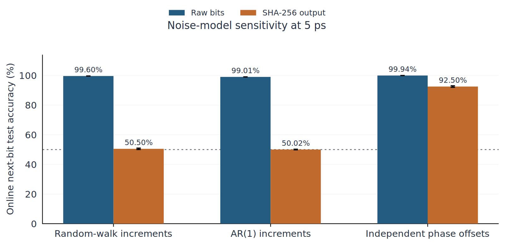
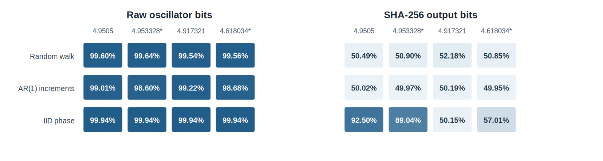

# Two Identical Histograms. Two Very Different Futures.

*Why a failed prediction test does not prove a signal is unpredictable.*

## Opening: Two Identical Histograms

Imagine two sequences, each containing 74,160 integers ranging from 0 to 99.

Their histograms are identical, bin for bin. Every number appears exactly as often in one sequence as in the other.

But can we predict which number comes next?

To find out, I tested a simple periodicity-based predictor on a held-out test segment. The results were striking:

- **Sequence 1: 100.00%** prediction accuracy
- **Sequence 2: 1.34%** prediction accuracy (close to the 1% chance level for uniform guesses among 100 values)



*Figure 1. Experiment A: The original sequence and its shuffled counterpart have identical empirical histograms. However, a periodicity-based predictor achieves 100.00% first-guess accuracy on the original sequence and 1.34% after shuffling, evaluated on held-out test data.*

If the two sequences have identical distributions, why is one so much easier to predict?

The difference lies in their order. The first sequence contains a repeating pattern, while the second is obtained by shuffling exactly the same values. The shuffle preserves the histogram but disrupts the temporal structure exploited by this predictor.

A histogram describes the marginal distribution: which values appear and how frequently. It tells us nothing about the temporal dependence between successive values.

This distinction matters beyond a simple statistical puzzle. The same issue arises when evaluating random number generators, sensor signals, and cryptographic hash outputs.

**An output that looks random does not necessarily come from an unpredictable source.**

## Section 1: A Random-Looking Output Can Still Have a Memory

A number-guessing game is a familiar exercise for people learning Python. While teaching programming to elementary school students as a part-time job, I decided to build one myself and experiment with different implementations.

My research focuses on analog semiconductor circuit design, so I also began building games that combined software with hardware. This led me to explore different ways of generating random numbers.

One question caught my attention: **What happens to the regularity of a bit sequence after it passes through SHA-256?**

To investigate, I used a synthetic model of a ring oscillator (RO), a circuit commonly used in hardware random number generators.

I set the oscillator frequency to 50 MHz, corresponding to a period of 20 ns. The ratio of the oscillation frequency to the sampling frequency was r = 4.9505, giving a sampling frequency of approximately 10.10 MHz.

I then divided the generated raw bitstream into 256-bit blocks and hashed each block separately with SHA-256.

Without jitter, the raw bitstream repeats every 2,000 bits. Because the bits are grouped into 256-bit blocks before hashing, the SHA-256 output repeats every 32,000 bits. This follows from the least common multiple of 2,000 and 256.

In other words, even a SHA-256 output can be perfectly predictable when its input follows a repeating pattern.

Next, I introduced synthetic cumulative phase jitter. Here, σ_t represents the standard deviation of the timing error added at each sampling step. I set σ_t = 5 ps, allowing small timing deviations to accumulate over time.

Using the same fixed-template predictor, I obtained:

- **0 ps jitter:** 100% prediction accuracy
- **5 ps jitter:** 49.99% prediction accuracy

For binary prediction, 49.99% is essentially chance-level performance.

Yet this result only shows that the fixed-template predictor could no longer exploit the original recurrence. It does not establish that the underlying source had become unpredictable.

*Did the source lose its regularity, or did the predictor simply lose the pattern it relied on?*

## Section 2: Why the Hash Output Stops Repeating

The key is the 256-bit block boundary. A single differing input bit makes two blocks non-identical, and their SHA-256 digests will typically differ in many output positions. I measured three match rates at a lag of 32,000 bits:
1. The raw-bit match rate.
2. The exact match rate of complete 256-bit input blocks.
3. The SHA-256 output-bit match rate.

SHA-256 exhibits the avalanche effect: changing one input bit typically changes approximately half of the digest bits. This is a statistical tendency, not a guarantee for each pair of inputs.

Let q be the fraction of exactly matching input blocks, and s the output-bit match rate conditioned on differing input blocks.

The resulting SHA-256 output-bit match rate, p_SHA, is:


The identity separates matching and non-matching input blocks. Since I observed s ≈ 0.5 for differing blocks, it becomes:



At 5 ps, q was 1.19%, implying an output-bit match rate near 50.60%; the simulation yielded 50.62%.



*Figure 2. Experiment D: Match rates at a 32,000-bit lag as a function of jitter magnitude. Compares RO raw bits, exact match rates of 256-bit SHA-256 input blocks, and SHA-256 output bit match rates. Aggregated over 30 seeds (0 ps is deterministic); error bars indicate 95% confidence intervals. Note that this represents fixed-lag match rates, not predictor accuracy.*

Meanwhile, raw bits still matched at 92.52% at this lag. Frequent raw-bit matches can therefore coexist with almost chance-level hash-output matches.

SHA-256 created no new physical entropy. It made the remaining raw-bit structure harder to observe at this particular lag. These match rates are descriptive statistics, not bounds on every possible predictor.

## Section 3: What Happens When the Predictor Is Allowed to Search?

Could a predictor recover the structure without being told the theoretical periods of 2,000 and 32,000 bits? I tested this by allowing it to discover candidate lags from the training data.

I split the time series chronologically into three parts:
- **50% discovery:** search for candidate lags.
- **20% validation:** choose among the candidates.
- **30% test:** measure online prediction accuracy.

Test data never enters lag discovery or validation. During online testing, previously observed test bits are available, but the current or future answers are not.

Here is an abridged excerpt from [experiment_F.py](../experiments/experiment_F.py). It selects a lag using training and validation data, then uses the selected lag for online prediction. The full implementation handles the acceptance threshold and majority-class fallback.

```python
candidates = discover_lag_candidates(bits[:DISCOVERY_CUT], max_lag, top_k)
vi = np.arange(DISCOVERY_CUT, TRAIN_CUT)
actual = bits[vi]
base = float(np.mean(actual == majority(bits)))
best = None
for lag, strength in candidates:
    agreement = float(np.mean(actual == bits[vi - lag]))
    flip = agreement < 0.5
    score = 1 - agreement if flip else agreement
    item = (score, -lag, lag, flip, strength)
    if best is None or item[:2] > best[:2]:
        best = item
score, _, lag, flip, strength = best
accept = bool(score - base >= min_gain)

# In evaluate(), choose_lag returns this decision before testing.
decision = choose_lag(bits, max_lag, top_k, min_gain)
t = np.arange(TRAIN_CUT, N)
if decision["accept"]:
    pred = bits[t - decision["lag"]] ^ np.uint8(decision["flip"])
    blind = float(np.mean(pred == bits[t]))
```

The 5 ps test results are:

**Table 1. Experiment F: Online blind-lag prediction at 5 ps**

| Prediction target | Online test accuracy |
|:--|--:|
| **RO raw bits** | **99.60%** |
| SHA-256 output | 50.59% |
| Shuffled raw-bit control | 49.96% |



*Figure 3. Experiment F: Online next-bit prediction accuracy for RO raw bits (left) and SHA-256 output (right). Data was partitioned chronologically into 50% discovery, 20% validation, and 30% test, with lags selected exclusively using the discovery and validation splits. During testing, bits observed prior to the prediction step are accessible. Non-zero jitter conditions are aggregated over 12 seeds; error bars indicate 95% confidence intervals.*

These numbers describe different tests: Section 1 used a fixed SHA-256 template; here the 99.60% result comes from an online raw-bit predictor with a discovered lag. They are not directly comparable scores for competing predictors on the same target.

At 2 ps, the SHA-256 lag search reached 53.38%, versus 52.29% for a prespecified lag of 32,000. Its most frequent choice, 15,616 = 61 × 256, aligns with block boundaries and corresponds to 15,616 × 4.9505 = 77,307.008 oscillator cycles. The 1.10-point gap alone is insufficient to establish statistical superiority. At 5 ps, the searched predictor scored 50.59%.

Why could the raw-bit predictor still reach 99.60% at 5 ps? The answer lies in short approximate phase recurrences: lag 101 at 5 ps and an inverted lag 10 at higher jitter.

## Section 4: Why a Short Imperfect Period Can Beat a Perfect Long One

A short approximate recurrence can beat an exact but much longer period when noise accumulates with elapsed samples.

At 5 ps, the predictor selected lag 101 instead of the exact 2,000-bit period.

For a frequency ratio of 4.9505:


After 101 samples, the oscillator phase nearly returns to its starting point. At higher jitter (20–50 ps), lag 10 offered another relationship:


A signal 10 samples away is shifted by almost exactly half a period. Therefore, by inverting the bit from 10 samples ago, the predictor can estimate the current bit with high accuracy.

For lag L, the phase difference combines a deterministic offset δ_L and the noise accumulated over L steps:



Here ε_k is independent phase-increment noise in oscillator-cycle units. At 50 MHz and 5 ps per step:

**Table 2. Phase-offset and jitter comparison at 5 ps**

| Lag (samples) | Deterministic phase offset (time equivalent) | Accumulated jitter, standard deviation (time equivalent) |
|--:|--:|--:|
| 101 | 10 ps | approximately 50 ps |
| 2,000 | 0 ps | approximately 224 ps |

Lag 2,000 has no deterministic offset but accumulates more noise. At 5 ps, the discovered-lag predictor scored 99.60% versus 98.20% for the prespecified 2,000-lag predictor. This fits the phase-offset/noise trade-off, although bit errors also depend on phase wrapping and quantization thresholds.

At 50 ps, Experiment D's 32,000-lag raw-bit match rate was 49.62%, while Experiment F's unknown-lag online prediction accuracy was 98.50%. These are distinct metrics and protocols, illustrating why the lag and information available to the predictor must be specified.

This behavior is related to the role of sampling-frequency ratios and phase recurrence in coherent-sampling oscillator-based random number generators [3]. The present experiments use a separate synthetic model; they do not reproduce that paper's hardware results.

## Section 5: Change the Noise Model, Change the Conclusion

So far, cumulative phase noise has driven SHA-256 prediction toward 50%. I next compared three noise processes at ratio 4.9505 and a 5 ps model setting:
- **Cumulative random walk:** independent phase increments accumulate.
- **AR(1) phase increments:** strongly correlated increments (ρ = 0.90) accumulate.
- **Independent phase perturbations:** phase offsets are independently resampled without accumulation.

The numerical setting of 5 ps does **not** represent equal physical noise power across the three models. This experiment tests sensitivity to temporal noise structure, not equal-strength noise sources.

Experiment G used six seeds, a 192,000-bit discovery budget, 40,000 validation bits, and a final 30% test split. These differ from Experiment F's protocol, so its 50.59% and Experiment G's 50.50% should not be treated as the same estimate.

**Table 3. Experiment G: Prediction accuracy at 5 ps and ratio 4.9505**

| Noise model | Raw-bit prediction accuracy | SHA-256 prediction accuracy |
|:--|--:|--:|
| Cumulative phase random walk | 99.60% | **50.50%** |
| AR(1) phase increments | 99.01% | **50.02%** |
| Independent phase perturbations | 99.94% | **92.50%** |



*Figure 4. Experiment G: Comparison of three phase noise models and online next-bit prediction accuracy at a frequency ratio of 4.9505 and jitter setting of 5 ps. Blue bars represent RO raw bits; orange bars represent SHA-256 outputs. Values are means across 6 seeds; error bars indicate 95% confidence intervals. The nominal jitter setting is not physically equivalent across models.*

Independent phase perturbations produced 92.50% SHA-256 prediction accuracy at ratio 4.9505. Varying the ratio changes the result:

**Table 4. Experiment G: SHA-256 prediction with independent phase perturbations at 5 ps**

| Oscillation-to-sampling ratio | SHA-256 prediction accuracy |
|--:|--:|
| 4.9505 | **92.50%** |
| approximately 4.953328 | **89.04%** |
| approximately 4.618034 | **57.01%** |
| 4.917321 | **50.15%** |

The ratio near 4.953328 is defined as 4.9505 + 0.002√2, which is irrational, yet gives 89.04% accuracy. In contrast, 4.917321 is rational (4,917,321/1,000,000) but gives only 50.15%. Thus, rationality itself is not the deciding factor. In these experiments, the relevant question is whether the lag search finds a useful approximate recurrence aligned to 256-bit block boundaries and whether that recurrence survives the chosen noise process.



*Figure 5. Experiment G: Online next-bit prediction accuracy across four frequency ratios and three phase noise models at a 5 ps jitter setting. Left panel shows RO raw bits; right panel shows SHA-256 outputs. Each cell represents the 6-seed mean (darker shades indicate higher accuracy), evaluated using 192,000 discovery bits, 40,000 validation bits, and a 30% final test split. Frequency ratios "4.953328*" and "4.618034*" are rounded displays of 4.9505 + 0.002√2 and 4 + (√5 − 1)/2, respectively. The 5 ps value does not imply physically equivalent noise strength across models.*

Independent phase offsets do not accumulate. At ratio 4.9505, 256-bit input blocks exactly matched 84.96% of the time at lag 32,000, allowing substantial hash-output recurrence. That descriptive block-match rate is distinct from the 92.50% online prediction accuracy.

RO-based true random number generators can use physical oscillator jitter as an entropy source [2]. Real circuits also exhibit supply variation, temperature drift, and correlated noise; the synthetic random walk does not model all of these effects. Independent phase offsets serve only as a comparison model, not a description of PLL clocks.

What Experiment G demonstrates is that even with the exact same SHA-256 function, the predictability of the output depends heavily on the combination of the phase noise's temporal structure and the sampling ratio. The 92.50% figure is simply the outcome obtained under one specific combination of those conditions.

## Section 6: What a Failed Prediction Test Actually Tells Us

What does a prediction score near 50% actually establish?

It says that a particular predictor failed under a particular information and evaluation protocol.

It does not prove any of the following:
- That the generating process has lost all regularity.
- That a different predictor could never succeed.
- That the output is cryptographically secure or has sufficient entropy; entropy assessment requires separate evidence and procedures [1].

(Note: All experiments in this study are based on synthetic RO models and are not measurements from physical devices. Furthermore, the fixed-template prediction in Section 1, the simple match rates in Section 2, and the online predictions in Sections 3 and 5 were each designed under different evaluation conditions. For detailed implementations, confidence intervals, per-seed results, and additional model comparisons, please refer to the GitHub repository linked at the end of this article.)

I use five questions to interpret a prediction result:
1. **Target:** raw signal or conditioned output?
2. **Information:** fixed template or online access to observed history?
3. **Lag selection:** prespecified or learned from training data?
4. **Noise:** accumulated, correlated, or independently resampled?
5. **Other tests:** what do block matches and lagged correlations reveal?

## Closing: Randomness Is Not a Single Number

The opening sequences had identical histograms but different test accuracies: 100.00% and 1.34%. Their order, not their marginal distribution, made the difference.

The same distinction appears after SHA-256: with cumulative phase noise, a predictor found 99.60% accuracy on raw bits despite chance-level hash-output performance; under a different noise model and sampling ratio, even hashed bits reached 92.50%. These results apply only to the stated synthetic models and prediction protocols.

SHA-256 can obscure a specific recurrence without proving that the source is unpredictable.

**Prediction accuracy is a property of a particular test, not a certificate of randomness.**

## References and Reproducibility

All figures and equation images in this article were prepared by the author from synthetic experiments unless otherwise noted.

- [1] NIST, *Recommendation for the Entropy Sources Used for Random Bit Generation* (2018), NIST SP 800-90B. https://doi.org/10.6028/NIST.SP.800-90B
- [2] M. Baudet, D. Lubicz, J. Micolod, A. Tassiaux, *On the Security of Oscillator-Based Random Number Generators* (2011), Journal of Cryptology 24, 398–425. https://doi.org/10.1007/s00145-010-9089-3
- [3] A. Peetermans, V. Rožić, I. Verbauwhede, *Design and Analysis of Configurable Ring Oscillators for True Random Number Generation Based on Coherent Sampling* (2021), ACM Transactions on Reconfigurable Technology and Systems. https://doi.org/10.1145/3433166

Figure 5 can be recreated from the [Experiment G summary CSV](../data/experiment_G_highlights.csv) using the [Python regeneration script](../experiments/plot_G_ratio_sensitivity.py).

Implementation details can be verified in [the unknown-lag search code](../experiments/experiment_F.py), [the noise-model comparison code](../experiments/experiment_G.py), [the evaluation protocol audit](evaluation_protocol_audit.md), and [the theoretical notes on phase recurrence](phase_recurrence_theory.md). All results are derived from synthetic RO models and do not constitute physical device measurements, validations of hardware entropy rates, or evaluations of the cryptographic security of SHA-256.
