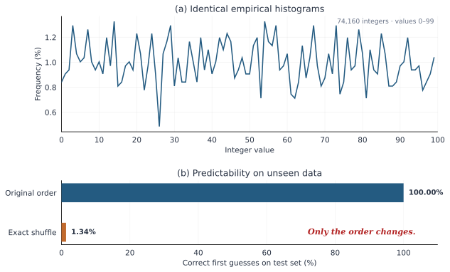
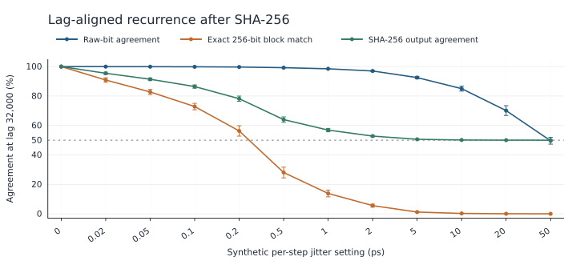
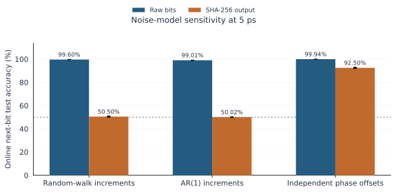
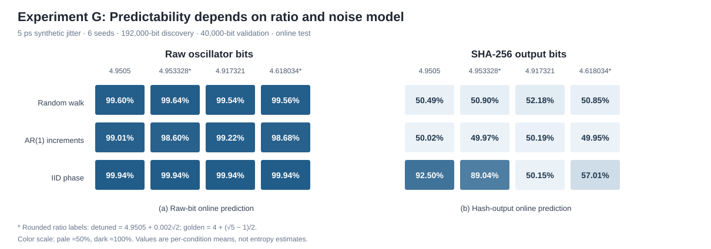

# Two Identical Histograms. Two Very Different Futures.
同じヒストグラム、まったく異なる未来――なぜ予測テストの失敗は、信号の予測不可能性を証明しないのか

## Opening ー Two Identical Histograms

手元に、0から99までの整数が74,160個並んだ「2つの数列」があると想像してみてください。

まずそれぞれの数列に含まれる数字の出現回数を数え、ヒストグラムを作ってみます。すると、2つのグラフは100%完全に一致しました。どの数字が何回現れるかという統計的な偏りは、2つの数列の間でまったく同じです。

では、この2つの数列の「未来」を予測することはできるでしょうか？

周期性を検出するシンプルな予測器を用意し、まだ見せていないテスト区間での予測精度を測ってみました。
すると結果は驚くべきものでした。

- 数列1の予測精度：100%

- 数列2の予測精度：1.34%（当てずっぽうの1%とほぼ同じ）

If the two sequences have identical distributions, why is one so much easier to predict?
タネを明かせばシンプルです。片方の数列は規則的な順序で並んでおり、もう片方はそれを完全にシャッフルしたものです。

ヒストグラムが教えてくれるのは「どの値がどれだけの頻度で出るか」という**周辺分布**だけです。
そこからは「どの値の次にどの値が出やすいか」という**時間依存性**つまりデータの「順序の記憶」が完全に抜け落ちています。

これは単なる統計のパズルではありません。私たちが乱数生成器やセンサー信号、あるいは暗号学的なハッシュ関数の出力を評価するとき、これとまったく同じ罠に陥ることがあります。「出力がランダムに見えること」と「背後の信号が予測不可能であること」は、イコールではないのです。

## Section 1 — A Random-Looking Output Can Still Have a Memory
Pythonを学ぶとき、多くの人が一度は作るであろう「数当てゲーム」。私もアルバイトで小学生にプログラミングを教える中で、自分でも作ってみようと思い、さまざまな書き方を試していました。

普段は半導体のアナログ回路設計を研究していることもあり、次第にソフトウェアだけでなく、ハードウェアを組み合わせたゲームも作るようになりました。

その過程で、乱数を生成する方法にも興味が広がりました。いくつかの乱数生成器を作って試しているうちに、今回紹介する現象に行き当たったのです。

特に気になったのは、元の数列にある規則性が、SHA-256を通すことでどのように変わるのか、という点でした。

この問題を掘り下げるため、ハードウェア乱数生成器などでよく使われるリングオシレータ（RO：Ring Oscillator）の合成モデルを使って実験してみましょう。

発振周波数を $f_{\mathrm{RO}}=50\,\mathrm{MHz}$（周期20 ns）、発振・サンプリング周波数比を $r=4.9505$（サンプリング周波数は約10.10 MHz）に設定します。今回の「ジッタ5 ps」は、累積位相ランダムウォークモデルにおいて**各サンプル間の位相増分に加わる時間誤差の標準偏差** $\sigma_t$ のことです。周期単位の位相増分誤差の標準偏差は $f_{\mathrm{RO}}\sigma_t$ となります。

生成した生ビット列（RO生ビット）を、実験上の設定として256ビットずつ区切り、各ブロックをSHA-256に入力して256ビットのダイジェストを得ます。SHA-256そのものが256ビット固定長の入力を要求するわけではありません。

もし、システムにノイズ（ジッタ）がまったく無ければどうなるでしょうか？
周波数比の数学的な性質から、生のビット列は 2,000ビット周期 で同じパターンを繰り返します。そして、それを256ビット単位で処理するSHA-256の出力もまた、32,000ビット周期 の完全な繰り返しになります。過去32,000ビットのテンプレートを記憶しておけば、SHA-256の出力であっても未来を100%予測できます。

ではここに、現実の回路で避けられない「累積位相ジッタ（時間とともに少しずつズレが溜まっていくノイズ）」をほんの少し、5ピコ秒（ps）だけ加えてみます。同じ固定テンプレート予測器でSHA-256の出力を予測すると、結果は劇的に変わります。

- ジッタ 0 ps： 予測精度 100%（SHA出力の固定テンプレート予測）
- ジッタ 5 ps： 予測精度 49.99%（同じ予測器）

0か1かを当てる予測で49.99%という精度は、ほぼコイントスと同じです。しかし、注目したいのは単に予測器が外れたことではありません。**わずかなジッタを加えただけで、SHA-256の出力に見えていた周期性が急激に失われたこと**です。

ここで「信号はランダムになった」と結論づけるのは早計です。SHA-256によって元の規則性が消えたのか。それとも、出力からその規則性を読み取りにくくなっただけなのか。この違いを調べる必要があります。

Did the underlying signal become unpredictable, or did our predictor simply lose the pattern it was using?

## Section 2 — Why the Hash Output Stops Repeating

この急激な変化を理解する鍵は、本実験では**256ビットずつ区切った入力にSHA-256を適用していること**にあります。生ビットの多くが再現されていても、ブロック内のたった1ビットが違えば、同一入力に対する出力の再現性は失われます。そこで、32,000ビットのラグにおける3つの「一致率」を調べました。

1. 生ビットの周期的な一致率

2. SHA-256の入力ブロック（256ビット全体）の完全一致率

3. SHA-256の出力ビットの一致率

SHA-256には、入力の小さな変化が出力全体に広がる「アバランシェ効果」という性質があります。一般に、入力ブロックが異なる場合、対応する出力ビットの約半数が一致すると期待されます。ただし、これは統計的な性質であり、あらゆる入力ペアで必ず半数のビットが反転するという意味ではありません。

ここで、256ビットの入力ブロックが比較対象と完全一致する割合を \(q\)、異なる入力ブロックに対してSHA-256出力の対応ビットが一致する割合を \(s\) と定義します。

すると、出力ビットの一致率は、

$$
p_{\mathrm{SHA}}=q+(1-q)s
$$

と表せます。

これは一致する入力と一致しない入力に場合分けした恒等式です。さらに、今回のデータでは異なる入力ブロックに対する出力ビット一致率がおよそ50%だったため、

$$
p_{\mathrm{SHA}}\approx\frac{1+q}{2}
$$

と近似できます。

5 psの条件で測定された入力ブロックの完全一致率は1.19%でした。この値から予想されるSHA-256出力ビット一致率は50.60%となり、シミュレーションで得られた50.62%とよく一致しました。

*Figure 2. ジッタ量を変えたときの32,000ビットラグにおける生ビット・SHA入力ブロック・SHA出力の一致率（30シード、エラーバーは95%信頼区間）。*

同じ5 psの条件で、生ビットのラグ一致率は92.52%でした。それでも入力ブロックの完全一致率は1.19%まで低下し、SHA-256出力ビットの一致率は50.62%になりました。**生ビットの高い一致率と、ハッシュ後の約50%という一致率は両立します。**

重要なのは、SHA-256が新しい物理的な乱数源を生み出したわけではないことです。ブロック内の差異が出力全体に波及するため、生ビットに残る規則性が、同じラグで見たハッシュ出力には現れにくくなったのです。なお、ここで測っているのはラグを固定したビット一致率であり、あらゆる予測器の精度ではありません。

## Section 3 — What Happens When the Predictor Is Allowed to Search?
元の生ビットに規則性が残っているのなら、それを取り出すことはできるのでしょうか？

ここからが、この実験の最も面白いところです。今度は予測器に対して、2,000や32,000といった理論上の周期を事前に一切教えず、データの中から自分で使える周期（ラグ）を探索させてみます。

フェアな評価を行うため、時系列データを順序通りに次の3つに厳密に分割しました。
- 50% Discovery（探索）： 有用なラグの候補を探す区間

- 20% Validation（検証）： 候補の中から最良のラグを選ぶ区間

- 30% Test（テスト）： 最終的な予測精度を測る未知の区間
ラグの探索と選択には最終テスト区間を使いません。一方、テスト時はオンライン逐次方式で、**予測するビットより前に観測済みのテストビットは参照できます**。現在の正解や未来のビットを使って予測するわけではありません。

ジッタ 5 ps の条件で、この「自ら周期を探索する予測器」を3つの対象に適用した結果がこちらです。

| 予測対象 | 未知ラグ探索による精度 |
|---|---:|
| **RO生ビット** | **99.60%** |
| SHA-256出力 | 50.59% |
| 生ビットのシャッフル対照 | 49.96% |

*Figure 3. 周期を事前に与えないオンライン予測の結果。探索・検証でラグを選択し、最終テスト区間で評価した。*

ここで評価条件を区別しておきます。Section 1の約50%は、SHA-256出力を**固定テンプレート**で予測した精度です。一方、ここでの99.60%は、RO生ビットを**未知ラグ探索に基づいてオンライン予測**した精度です。両者は同じデータに対する予測器の優劣を直接比較した結果ではありません。予測対象と利用可能な過去情報を明示することが、この実験の重要な前提です。

SHA-256出力でも、ラグ探索がまったく無意味になったわけではありません。実験Fの2 ps条件では、未知ラグ探索の平均精度は**53.38%**となり、事前に32,000ラグを指定した予測器の**52.29%**を上回りました。探索器が最も多く選んだラグは **15,616** で、$15{,}616=61\times256$ とブロック境界に整列し、$15{,}616\times4.9505=77{,}307.008$ と位相もほぼ一致します。ただし、1.10ポイント程度の差だけで統計的な優位性を断言することはできません。5 psではSHA-256出力の予測精度は50.59%にとどまります。

では、なぜRO生ビットでは5 psでも99.60%の精度が得られたのでしょうか。5 psで選択された101ラグと、ジッタの大きい条件で利用された10ラグの反転関係を調べます。

## Section 4 — Why a Short Imperfect Period Can Beat a Perfect Long One
厳密な周期である2,000ラグよりも、101ラグや10ラグの近似周期が有用だったのはなぜでしょうか。位相の有理近似と、累積する雑音の両方を考える必要があります。

5 psの条件で予測器が発見したのは、理論上の厳密な周期である2,000ラグではなく、101ラグという短い近似周期でした。

今回の発振・サンプリング周波数比は4.9505なので、

$$
101\times4.9505=500.0005
$$

となります。101サンプル離れた時点では、発振器の位相がほぼ元の位置に戻るのです。

さらにジッタを大きくした20〜50 psの条件では、予測器は別の関係を利用しました。

$$
10\times4.9505=49.505
$$

10サンプル離れた信号は、ほぼ半周期ずれています。したがって、10サンプル前のビットを反転することで、現在のビットを高い精度で予測できます。

では、なぜ厳密な周期である2,000ラグより、短い近似周期が有利になるのでしょうか。

ラグ $L$ での位相差は、決定論的な位相のずれ $\delta_L$ と、その間に蓄積する確率的な位相増分に分けられます。

$
\Delta\phi_L=\delta_L+\sum_{k=n-L+1}^{n}\varepsilon_k,
\qquad \sigma_{\Delta\phi}(L)=f_{\mathrm{RO}}\sigma_t\sqrt{L}
$

ここで $\varepsilon_k$ は周期単位の独立な位相増分雑音です。50 MHz、1ステップ当たり5 psのモデルでは、次の値になります。

| ラグ | 理想位相関係からのずれ（時間換算） | 累積ジッタの標準偏差（時間換算） |
|---|---:|---:|
| 101 | 10 ps | 約50 ps |
| 2,000 | 0 ps | 約224 ps |

2,000ラグは決定論的な位相ずれこそゼロですが、101ラグよりも雑音が蓄積します。実験Fの5 ps条件では、未知ラグ探索による**99.60%**に対し、事前指定した2,000ラグの予測精度は**98.20%**でした。これは位相ずれと雑音蓄積のトレードオフと整合的です。ただし、二つの数値を足せばビット誤り率になるわけではなく、位相の折り返しやビット化の閾値も影響します。

50 psでは、実験Dの**32,000ラグでの生ビット一致率49.62%**に対し、実験Fの未知ラグオンライン予測は**98.50%**でした。前者は固定ラグの記述統計で、後者は別の評価プロトコルによる予測精度です。指標を混同することはできませんが、ラグと観測条件によって見える規則性が大きく変わることを示しています。

## Section 5 — Change the Noise Model, Change the Conclusion
これまでの累積位相ランダムウォークモデルでは、SHA-256出力の予測精度は約50%に低下しました。しかし、それはSHA-256を通せば必ず50%になるという意味ではありません。**入力の時間構造が違っても、同じことが起こるのでしょうか。** そこで、ノイズの生成モデルを変えて調べました。周波数比 $4.9505$、ジッタの大きさ $5\text{ ps}$ は同じまま、位相ノイズの入り方を3つの異なるモデルで比較しました。

1. **累積位相ランダムウォーク**： ズレが時間とともにどんどん蓄積していくモデル（これまでの実験で使用）
2. **AR(1)位相増分**： ズレの増分に少しだけ前後の相関がある蓄積モデル
3. **独立位相ゆらぎ**： 各時点でのズレが毎回リセットされ、過去に蓄積しないモデル

ここで注意したいのは、3つのノイズモデルに与えた「5 ps」という数値が、物理的に等価なノイズ強度を意味するわけではないことです。

累積ランダムウォークでは、位相増分のゆらぎが時間とともに積み重なります。AR(1)モデルでは、その増分に時間相関があります。一方、独立位相ゆらぎモデルでは、各サンプルの位相偏差が独立に与えられ、過去の偏差は蓄積しません。

したがって、今回の比較は「同じ強さのノイズを3種類加えた実験」ではなく、「異なる時間的なノイズ生成過程を仮定した感度解析」です。

この違いを踏まえ、ノイズモデルを変更した場合にSHA-256後の予測性能を比較しました。以下は、**実験Gの周波数比4.9505、ジッタ5 ps、6シード**による結果です。実験F（12シード、50%探索・20%検証）とは異なり、ここでは探索予算192,000ビット、検証40,000ビット、最終テスト30%を用います。このためFの**50.59%**とGの**50.50%**は同じ推定値ではありません。実験Dの32,000ラグでの一致率も、Gの別シードによる記述統計とは直接一致しません。

結果は以下の通りです。
| ノイズモデル | 生ビットの予測精度 | SHA-256後の予測精度 |
|---|---:|---:|
| **累積位相ランダムウォーク** | 99.60% | **50.50%** |
| **AR(1)位相増分** | 99.01% | **50.02%** |
| **独立位相ゆらぎ** | 99.94% | **92.50%** |

*Figure 4. 実験Gの周波数比4.9505、ジッタ5 psにおけるノイズモデル比較（6シード）。周波数比は固定しており、5 psはモデル間で物理的に等価なノイズ強度を意味しない。*

独立位相ゆらぎモデルでのSHA-256出力予測精度は**92.50%**でした。ただし、これは同モデルなら常に高い精度になるという意味ではありません。周波数比を変えた実験Gの結果を比較します。

| 周波数比 | 独立位相ゆらぎ・5 ps・SHA-256後のオンライン予測精度 |
|---|---:|
| 4.9505 | **92.50%** |
| 約4.953328 | **89.04%** |
| 約4.618034 | **57.01%** |
| 4.917321 | **50.15%** |

約4.953328の条件は、実装では $4.9505+0.002\sqrt2$ と定義した**無理数比**です。それでも89.04%の精度が得られました。厳密な有理数比であることは必須ではありません。今回の範囲では、256ビットのブロック境界と整列する良好な**近似周期**が探索範囲内にあり、それが雑音の下でどれだけ再現されるかが結果に関係します。これはSection 4の数論的な位相関係ともつながります。

*Figure 5. 実験G：5 ps、6シード、探索192,000ビット・検証40,000ビット。4種類の周波数比と3種類のノイズモデルを比較したオンライン予測精度。左がRO生ビット、右がSHA-256出力。*

なぜこんなことが起きるのでしょうか？
独立位相ゆらぎモデルでは位相偏差が累積しないため、離れた時点でも入力ブロックを再現しやすくなります。このモデルの32,000ビットラグでの256ビットブロック完全一致率は約84.96%でした。これは、SHA-256出力に高い一致率が残る仕組みを説明します。ただし、このブロック一致率と表にある**オンライン予測精度92.50%は別の評価量**です。

実際のフリーランリングオシレータでは、周波数ゆらぎから位相雑音が累積する場合があります。RO型TRNGには、こうした物理的ジッタをエントロピー源として利用する設計があります。ただし実回路には電源変動や温度ドリフト、相関雑音などもあり、ここでの単純なランダムウォークモデルが実機を代表するわけではありません。独立位相ゆらぎは比較のための対照モデルであり、PLLクロック一般のモデルでもありません。

実験Gが示すのは、同じSHA-256であっても、出力の予測可能性が**位相雑音の時間構造とサンプリング比の組み合わせ**に依存するということです。92.50%は、その中の一つの条件で得られた結果です。

## Section 6 — What a Failed Prediction Test Actually Tells Us
ここまでの実験を通じて、私たちはようやく冒頭の大きな問いに答えることができます。
ある信号に対して予測テストを行い、その結果が「50%（予測失敗）」だったとき、それは何を意味するのでしょうか？

低い予測精度が示すのは、あくまで「与えられた情報、アルゴリズム、観測条件のもとで、その特定の予測器が十分な精度を得られなかった」という事実です。

それは、以下のことを証明するものではありません。

- データ生成過程のすべての規則性や情報が失われたこと

- 別のアプローチをとる予測器でも絶対に予測できないこと

- ましてや、その出力が「暗号学的に安全である」ことや「真のエントロピーを十分に持っている」こと
(※本研究の実験はすべて合成ROモデルに基づくものであり、実デバイスの測定ではありません。また、Section 1の固定テンプレート予測、Section 2の単純一致率、Section 3・5のオンライン予測はそれぞれ異なる評価条件で設計されています。詳細な実装、信頼区間、シード別の結果、追加モデルの比較については、記事末尾のGitHubリポジトリを参照してください。)

私たちが実務でデータのランダム性や予測可能性を評価するとき、単一の精度スコアに騙されないためには、常に以下の5つのチェックリストを明示する必要があります。

1. 何を予測しているか？（生の信号そのものか、ハッシュ関数などで変換された後の出力か）

2. 予測器はどんな過去情報を利用できるか？（固定のテンプレートか、オンラインでの逐次更新か）

3. 特徴量や周期を事前に与えたか？（理論値を教えたか、データから探索させたか）

4. ノイズとデータ生成過程にどんな仮定があるか？（ノイズは累積するか、独立しているか）

5. 精度以外にどのような依存関係を確認したか？（複数のラグやブロック単位での一致率はどうなっているか）

## Closing — Randomness Is Not a Single Number
もう一度、冒頭の「2つのヒストグラム」を思い出してみてください。

2つの数列は、まったく同じ分布（ヒストグラム）を持っていました。しかし、その「順序」が違えば、未来の予測可能性は100%と1.34%に大きく引き裂かれました。

同様に、SHA-256の出力に対してある予測器が50%の精度しか出せなかったとしても、その背後にある元の信号に予測可能な構造が残っていないとは限りません。今回のランダムウォークモデルでは短い近似周期を利用して生ビットを99.60%の精度で予測できました。また、独立位相ゆらぎと特定の周波数比の組み合わせではSHA-256出力でも92.50%の精度が得られました。どちらも、指定したモデルと予測プロトコルの下での結果です。

今回の実験で最も印象的なのは、SHA-256によって周期的な一致が見えにくくなった一方で、その結果だけでは元信号の予測可能性を語れなかったことです。

ランダム性や予測不可能性は、たった一つのテスト結果の数字だけでは判断できません。

Prediction accuracy describes a particular experiment. It is not a universal certificate of randomness.

## References and reproducibility

- [1] NIST, *Recommendation for the Entropy Sources Used for Random Bit Generation*, NIST SP 800-90B (2018). https://doi.org/10.6028/NIST.SP.800-90B
- [2] M. Baudet, D. Lubicz, J. Micolod, A. Tassiaux, *On the Security of Oscillator-Based Random Number Generators*, *Journal of Cryptology* **24**, 398–425 (2011). https://doi.org/10.1007/s00145-010-9089-3
- [3] A. Peetermans, V. Rožić, I. Verbauwhede, *Design and Analysis of Configurable Ring Oscillators for True Random Number Generation Based on Coherent Sampling*, *ACM Transactions on Reconfigurable Technology and Systems* (2021). https://doi.org/10.1145/3433166

図5は[Pythonの再生成コード](../experiments/plot_G_ratio_sensitivity.py)を実行すると、実験GのCSVから再作成できます。

実装の詳細は[未知ラグ探索のコード](../experiments/experiment_F.py)、[ノイズモデル比較のコード](../experiments/experiment_G.py)、[評価プロトコル監査](evaluation_protocol_audit.md)、[位相再帰の理論メモ](phase_recurrence_theory.md)で確認できます。いずれも合成ROモデルの結果であり、実デバイスの測定、実機のエントロピー率やSHA-256の暗号学的安全性の検証ではありません。