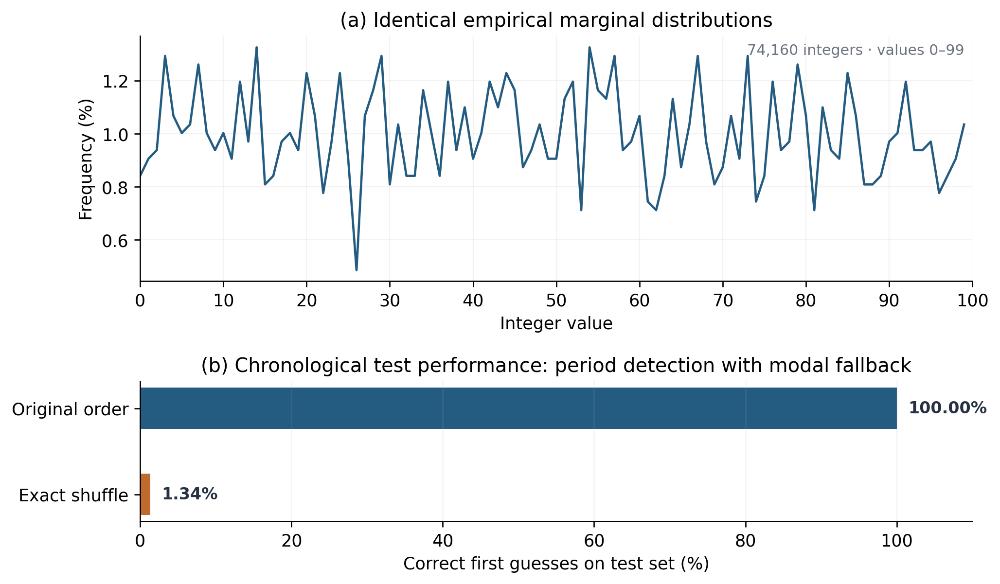

# Two Identical Histograms. Two Very Different Futures.
同じヒストグラム、全く異なる未来。ーーなぜ「予測テストの失敗」は「信号の予測可能性」を証明しないのか

## Opening ー Two Identical Histograms

手元に、0から99までの整数が74,160個並んだ「2つの数列」があると想像してみてください。

まずそれぞれの数列に含まれる数字の出現回数を数え、ヒストグラムを作ってみます。すると、2つのグラフは100%完全に一致しました。どの数字が何回現れるかという統計的な偏りは、2つの数列の間でまったく同じです。

では、この2つの数列の「未来」を予測することはできるでしょうか？

周期性を検出するシンプルな予測器を用意し、まだ見せていないテスト区間での予測精度を測ってみました。
すると結果は驚くべきものでした。

- 数列1の予測精度：100%

- 数列2の予測精度：1.34%（当てずっぽうの1%とほぼ同じ）

If the two sequences have identical distributions, why is one so much easier predict?
タネを明かせばシンプルです。片方の数列は規則的な順序で並んでおり、もう片方はそれを完全にシャッフルしたものです。

ヒストグラムが教えてくれるのは「どの値がどれだけの頻度で出るか」という**周辺分布**だけです。
そこからは「どの値の次にどの値が出やすいか」という**時間依存性**つまりデータの「順序の記憶」が完全に抜け落ちています。

これは単なる統計のパズルではありません。私たちが乱数生成器やセンサー信号、あるいは暗号学的なハッシュ関数の出力を評価するとき、これとまったく同じ罠に陥ることがあります。「出力がランダムに見えること」と「背後の信号が予測不可能であること」は、イコールではないのです。

## Section 1 — A Random-Looking Output Can Still Have a Memory
この問題を掘り下げるため、ハードウェア乱数生成器などでよく使われるリングオシレータ（RO：Ring Oscillator）の合成モデルを使って実験してみましょう。

今回は、発振とサンプリングの周波数比を $4.9505$ に設定し、生成された生のビット列（RO生ビット）を256ビットずつ切り出して、暗号学的ハッシュ関数である SHA-256 に通します。

もし、システムにノイズ（ジッタ）がまったく無ければどうなるでしょうか？
周波数比の数学的な性質から、生のビット列は 2,000ビット周期 で同じパターンを繰り返します。そして、それを256ビット単位で処理するSHA-256の出力もまた、32,000ビット周期 の完全な繰り返しになります。過去32,000ビットのテンプレートを記憶しておけば、SHA-256の出力であっても未来を100%予測できます。

ではここに、現実の回路で避けられない「累積位相ジッタ（時間とともに少しずつズレが溜まっていくノイズ）」をほんの少し、5ピコ秒（ps）だけ加えてみます。同じ固定テンプレート予測器でSHA-256の出力を予測すると、結果は劇的に変わります。

- ジッタ 0 ps： 予測精度 100%（SHA出力の固定テンプレート予測）
- ジッタ 5 ps： 予測精度 49.99%（同じ予測器）

0か1かを当てるゲームで、精度49.99%はコイントスと同じです。予測は完全に失敗しました。ここで、多くの人はこう結論づけたくなります。「5 psのジッタとSHA-256のおかげで、信号は完全にランダムになったのだ」と。

しかし、本当にそうでしょうか？ ここで次の問いが浮かび上がります。

Did the underlying signal become unpredictable, or did our predictor simply lose the pattern it was using?

## Section 2 — Why the Hash Output Stops Repeating

なぜジッタを少し加えただけで、SHA-256の出力から周期性が消えてしまったのでしょうか。そのメカニズムを解き明かすために、同じ周期（ラグ）における3つの「一致率」を比較してみます。

1. 生ビットの周期的な一致率

2. SHA-256の入力ブロック（256ビット全体）の完全一致率

3. SHA-256の出力ビットの一致率

SHA-256には「雪崩効果（Avalanche Effect）」という性質があります。入力される256ビットのうち、たった1ビットでも変われば、出力される256ビットは約半数がランダムに反転します。反対に、256ビットすべてが1ビットの狂いもなく完全に一致したときだけ、同じ出力が得られます。

この関係は、非常にシンプルな数式で表すことができます。

$$
p_{\text{SHA}}=q+\left(1-q\right)s
$$

- $q$：256ビットの入力ブロックが、1周期前と完全に一致する確率
- $s$：異なる入力ブロックが入ったときに、SHA出力ビットがたまたま一致する確率
  

SHA-256の性質上、入力が異なれば出力の一致率 $s$ は約 $1/2$（50%）になります。すると、式は次のように簡略化できます。

$$
p_{\text{SHA}}\approx\frac{1+q}{2}
$$

5 psのジッタを加えた実験では、生ビット自体は1周期前と高い確率で一致していました。しかし、「256個すべてのビットが同時に1つも欠けずに一致する確率 $q$」となると、わずかな位相のズレが原因で $q = 0.0119$（約1.19%） まで急落していたのです。

この $q = 0.0119$ を上の式に代入すると、予測されるSHA出力の一致率は 約50.60% になります。そして、実際の実験で観測された一致率は 50.62% でした。理論と実測が見事に一致しています。

ここから分かる重要な事実は、「SHA-256の出力で周期的な一致が見られなくなっても、元の生ビット列で同じことが起きているとは限らない」ということです。ハッシュ関数は「256ビット中1ビットのズレ」を「出力全体の破壊」へと増幅しただけであり、元の生ビット列にはまだ強い規則性が残っている可能性があるのです。

## Section 3 — What Happens When the Predictor Is Allowed to Search?
元の生ビットに規則性が残っているのなら、それを取り出すことはできるのでしょうか？

ここからが、この実験の最も面白いところです。今度は予測器に対して、2,000や32,000といった理論上の周期を事前に一切教えず、データの中から自分で使える周期（ラグ）を探索させてみます。

フェアな評価を行うため、時系列データを順序通りに次の3つに厳密に分割しました。
- 50% Discovery（探索）： 有良なラグの候補を探す区間

- 20% Validation（検証）： 候補の中から最良のラグを選ぶ区間

- 30% Test（テスト）： 最終的な予測精度を測る未知の区間
周期の探索や選択には、最終テスト区間の正解データは一切使用しません。また、テスト区間では1ビットずつ順番に予測していくオンライン逐次方式を採用しました。

ジッタ 5 ps の条件で、この「自ら周期を探索する予測器」を3つの対象に適用した結果がこちらです。

| 予測対象 | 未知ラグ探索による精度 |
|---|---:|
| **RO生ビット** | **99.60%** |
| SHA-256出力 | 50.59% |
| 生ビットのシャッフル対照 | 49.96% |

(※注：Section 1で見た「約50%」という数字はSHA-256の出力に対する固定テンプレート予測であり、今回の「99.60%」はRO生ビットに対するオンライン探索予測です。同じ対象を異なる予測器で比較したものではありません。この違いこそが、「何を予測対象とし、予測器にどんな観測条件を与えるかによって、得られる結論はまったく変わる」という事実を浮き彫りにしています。）

さらに興味深いのは、予測器がどうやって99.60%もの精度を叩き出したのか、その「中身」です。予測器が発見して利用したのは、理論上の厳密な周期である「2,000ラグ」ではなく、「101ラグ」や「10ラグ」という非常に短い近似周期だったのです。

## Section 4 — Why a Short Imperfect Period Can Beat a Perfect Long One
なぜ、数学的に完璧な「2,000ラグ」よりも、不完全なはずの「101ラグ」や「10ラグ」の方が役に立ったのでしょうか？ ここには、数論と回路の物理現象（位相拡散）が交差する美しい理由があります。

今回のサンプリング周波数比 $4.9505$ に、$101$ と $10$ をそれぞれ掛けてみましょう。

$$
101 \times 4.9505 = 500.0005 
$$

$$
10 \times 4.9505 = 49.505
$$

$101$ ステップ進むと、発振器は $500.0005$ 周期進みます。小数点以下が $.0005$ と極めてゼロに近いため、101ラグ離れたビット同士は、位相がほぼ完全に一致します。
一方、$10$ ステップ進むと $49.505$ 周期となり、小数点以下が $.505$（約半分）になるため、10ラグ離れたビット同士は、ほぼ半周期（0と1が）反転した関係になります。

数論における「ディリクレの近似定理」が示す通り、実数は分数（有理数）によって効率よく近似できます。予測器はデータの中から、この有理近似にあたる短いラグを自力で見つけ出したのです。

では、なぜ短いラグの方が有利なのでしょうか？ それは、累積位相ノイズ（ジッタ）の性質にあります。時間とともに蓄積するタイプの位相ノイズでは、ラグ $L$ が離れるほど、位相のズレの標準偏差 $\sigma_{\Delta\phi}(L)$ が次のように大きくなります。

$$\sigma_{\Delta\phi}(L) \propto \sqrt{L}$$

つまり、2,000ステップも待つと、その間にノイズが $\sqrt{2000}$ に比例して大きく蓄積し、せっかくの「数学的に厳密な周期」がノイズに埋もれてしまいます。それよりも、ノイズが蓄積しにくい10ステップや101ステップ先の「わずかに不完全だが、ノイズで汚れていない近似周期」を使う方が、はるかに高い精度で未来を予測できるのです。

「数学的な厳密さ」よりも「物理的なノイズ蓄積の少なさ」が勝る——これは、単なる機械学習のアプローチだけでは見えにくい、信号処理と物理モデルならではの洞察です。

## Section 5 — Change the Noise Model, Change the Conclusion
ここまでの実験で、「SHA-256を通せば予測精度は約50%に落ちる」ということが分かりました。では、この結論はどんな時でも常に成り立つのでしょうか？

それともう一歩踏み込んで、ノイズの性質（生成モデル）そのものを変えてみましょう。周波数比 $4.9505$、ジッタの大きさ $5\text{ ps}$ は同じまま、位相ノイズの入り方を3つの異なるモデルで比較しました。

1. **累積位相ランダムウォーク**： ズレが時間とともにどんどん蓄積していくモデル（これまでの実験で使用）
2. **AR(1)位相増分**： ズレの増分に少しだけ前後の相関がある蓄積モデル
3. **独立位相ゆらぎ**： 各時点でのズレが毎回リセットされ、過去に蓄積しないモデル

結果は以下の通りです。
| ノイズモデル | 生ビットの予測精度 | SHA-256後の予測精度 |
|---|---:|---:|
| **累積位相ランダムウォーク** | 99.60% | **50.50%** |
| **AR(1)位相増分** | 99.01% | **50.02%** |
| **独立位相ゆらぎ** | 99.94% | **92.50%** |

一番下の行に注目してください。ノイズを「独立位相ゆらぎ」に変えた瞬間、SHA-256を通した後の出力であるにもかかわらず、予測精度が 92.50% にまで跳ね上がりました。

なぜこんなことが起きるのでしょうか？
ノイズが過去に蓄積しない（独立している）場合、32,000ビットという長い周期が経っても、位相の基準点が遠くへ逃げていきません。そのため、256ビットの入力ブロック全体が1周期前と「完全一致」する確率 $q$ が高く保たれ、結果としてSHA-256の出力までもがそのまま繰り返されるようになったのです。

（なお、フリーラン発振器では位相ノイズが累積するのが自然であり、ここでの「独立位相ゆらぎ」は理論的な対照モデルです。現実のPLLクロックなどの挙動と単純に同一視することはできない点には注意が必要です。）

この実験Gが示す中心的なメッセージは明確です。「同じハッシュ関数を使っていても、入力される信号の時間的なノイズ構造が違えば、出力の予測可能性もまったく違ってくる」ということです。

## Section 6 — What a Failed Prediction Test Actually Tells Us
ここまでの実験を通じて、私たちはようやく冒頭の大きな問いに答えることができます。
ある信号に対して予測テストを行い、その結果が「50%（予測失敗）」だったとき、それは何を意味するのでしょうか？

低い予測精度が証明するのは、あくまで「与えられた情報、アルゴリズム、観測条件のもとで、その特定の予測器が予測に失敗した」という事実だけです。

それは、以下のことを証明するものではありません。

- データ生成過程のすべての規則性や情報が失われたこと

- 別のアプローチをとる予測器でも絶対に予測できないこと

- ましてや、その出力が「暗号学的に安全である」ことや「真のエントロピーを十分に持っている」こと
(※本研究の実験はすべて合成ROモデルに基づくものであり、実デバイスの測定ではありません。また、Section 1の固定テンプレート予測、Section 2の単純一致率、Section 3・5のオンライン予測はそれぞれ異なる評価条件で設計されています。詳細な実装、信頼区間、シード別の結果、追加モデルの比較については、記事末尾のGitHubリポジトリを参照してください。)

私たちが実務でデータのランダム性や予測可能性を評価するとき、単一の精度スコアに騙されないためには、常に以下の5つのチェックリストを明示する必要があります。

1. 何を予測しているか？（生の信号そのものか、ハッシュ関数などで変換された後の出力か）

2. 予測器はどんな過去情報を利用できるか？（固定のテンプレートか、オンラインでの逐次更新か）

3. 特徴量や周期を事前に与えたか？（理論値を教えたか、データから探索させたか）

4. ノイズとデータ生成過程にどんな仮定があるか？（ノイズは累積するか、独立しているか）

5. 精度以外にどのような依存関係を確認したか？（複数のラグやブロック単位での一致率はどうなっているか）

## Closing — Randomness Is Not a Single Number
もう一度、冒頭の「2つのヒストグラム」を思い出してみてください。

2つの数列は、まったく同じ分布（ヒストグラム）を持っていました。しかし、その「順序」が違えば、未来の予測可能性は100%と1.34%に大きく引き裂かれました。

同様に、SHA-256の出力に対してある予測器が50%の精度しか出せなかったとしても、その背後にある元の信号に予測可能な構造が残っていないとは限りません。短い近似周期を見つけ出せば生ビットは99.60%予測でき、ノイズの構造が変わればハッシュ出力さえも92.50%予測できてしまうことがあるのです。

ランダム性や予測不可能性とは、たった一つのテスト結果の数字で測れるものではありません。

Prediction accuracy describes a particular experiment. It is not a universal certificate of randomness.